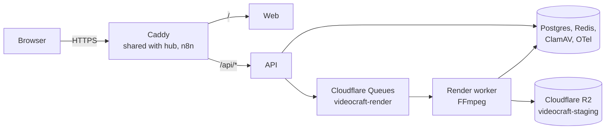

# VideoCraft staging runbook

How the staging site at https://videocraft.emancipationdevelopment.org runs, how to deploy a new `main`, and what to do when a check fails.

## Overview

VideoCraft staging runs as seven Docker containers on the Oracle server `obed-operations-hub-a1` (130.61.84.214, ARM64), next to hub and n8n. Media lives in Cloudflare R2 and render jobs travel through Cloudflare Queues.

| Part | Where | Notes |
| --- | --- | --- |
| Site | https://videocraft.emancipationdevelopment.org | DNS A record at HostMaria (StackDNS) |
| Reverse proxy | `caddy` container, `/home/ubuntu/n8n-stack/Caddyfile` | `/api/*` → API with `/api` stripped; `/` → web. Shared with hub and n8n |
| App containers | `videocraft-web`, `videocraft-api`, `videocraft-render-worker` | Images from `ghcr.io/obediko/videocraft-*:staging` |
| Data containers | `videocraft-postgres`, `-redis`, `-clamav`, `-otel` | Internal network only |
| Storage | R2 bucket `videocraft-staging` | Western Europe |
| Job queue | Cloudflare Queue `videocraft-render` | HTTP pull consumer |
| Stack files | `/opt/videocraft` on the server | `docker-compose.yml` + `.env` |
| Secrets | `/opt/videocraft/.env` (root only, mode 600) | Never in Git, chat or logs |
| Scripts | `ops/oci-staging/` in this repo | `deploy.sh`, `verify.sh` |



The API and web listen only on the server itself (127.0.0.1:18081 and :18080); Caddy is the only public entry point. The API puts render and preview jobs on the queue; the worker pulls them, writes results to R2 and records them in Postgres.

## Log in to the server

The server key `n8n_migration` lives in Oracle Cloud Shell, so log in from there; user `ubuntu`, `sudo` works.

1. Open https://cloud.oracle.com, sign in, and click the **>_** (Cloud Shell) icon at the top right.
2. Connect:

   ```bash
   ssh -o ServerAliveInterval=30 -i ~/.ssh/n8n_migration ubuntu@130.61.84.214
   ```

3. Check where you are before running anything: the prompt must read `ubuntu@obed-operations-hub-a1`. A prompt of `apochiobed@cloudshell` means you are still in Cloud Shell (the SSH session dropped); reconnect.

The other keys in Cloud Shell (`oci_key`, `oci-key.pem`, `ssh-key-2026-08-24 (2).key`) do not open this server.

**From PowerShell instead:** download `.ssh/n8n_migration` from Cloud Shell (Menu → Download), save it as `C:\Users\<you>\.ssh\n8n_migration`, lock it down once, then prefix server commands with `ssh`:

```powershell
icacls $HOME\.ssh\n8n_migration /inheritance:r /grant:r "$($env:USERNAME):R"
ssh -i $HOME\.ssh\n8n_migration ubuntu@130.61.84.214 "<command>"
```

Run that `ssh` line only from your PC, never from inside the server.

## Deploy the latest main

A deploy is safe to repeat: it reuses `/opt/videocraft/.env`, runs any new migrations, recreates only the three app containers and leaves hub, n8n and the Caddyfile alone.

1. **Wait for the images.** On GitHub → Actions → *Staging container images*, the newest run must be green for the commit you want (about 20 minutes). A cancelled run was superseded by a newer one. If a commit did not start a build, click **Run workflow** on `main`.
2. **Deploy and verify** (on the server):

   ```bash
   cd ~/VideoCraft && git pull -q && sudo bash ops/oci-staging/deploy.sh && sudo bash ops/oci-staging/verify.sh
   ```

3. **Free the replaced images** (each deploy leaves 5–6 GB behind):

   ```bash
   sudo docker image prune -f
   ```

   This removes only untagged images no container uses; `temporal-postgresql` runs on an untagged image and is skipped.

4. **Check health** any time:

   ```bash
   sudo docker ps --filter name=videocraft- && df -h / && free -m
   ```

The deploy is done when `verify.sh` ends with `passed=20 failed=0`.

## What verify.sh checks

Each run creates a throwaway project with a 15-minute test token and prints no secrets. A failure points at the part listed.

| # | Check | A failure points at |
| --- | --- | --- |
| 1 | Homepage returns 200 | Web container or Caddy |
| 2 | Web `/healthz` returns ok | Web container |
| 3 | HTTP redirects to HTTPS | Caddy site block |
| 4 | `/api/healthz` returns 200 | API container down or crash-looping |
| 5 | `/api/readyz` reports ok | Postgres or Redis unreachable |
| 6 | Browser code targets `/api` | Web image built with the wrong API address |
| 7 | Project created | Auth settings or database |
| 8 | Asset uploaded | ClamAV or R2 keys |
| 9 | Revision saved | API or database |
| 10 | Render job enqueued | Cloudflare Queues token or queue ID |
| 11 | Worker rendered to R2 and updated Postgres | Render worker, R2 or queue |
| 12 | Signed download returns an MP4 | R2 or download signing |
| 13 | Worker built a preview for an MKV upload | Media proxy job in the worker |
| 14 | Playback URL issued | Preview proxy or signing |
| 15 | Transcriber ran | Python/Whisper in the API image, memory |
| 16 | Music and image uploads accepted | Upload rules or ClamAV |
| 17 | Edit with music, graphics and b-roll saved | API edit route |
| 18 | 9:16 export rendered at 540×960 | Worker fonts, overlays, audio ducking |
| 19 | hub still 200 | Shared Caddy or server load |
| 20 | n8n still 200 | Shared Caddy or server load |

## Turn on the AI director (OpenAI)

Without a key, "Plan my video" uses the built-in rules director (strongest moments, a hook title, matching
music, format). With a key, an OpenAI vision model reads the transcript, looks at eight frames from the video
and plans the whole edit; every suggestion is still reviewed and ticked by you before anything changes.

1. Create a key at platform.openai.com (Project → API keys). Set a monthly budget there.
2. On the server, add it to the env file (never paste it into chat or commit it):

   ```
   sudo nano /opt/videocraft/.env
   OPENAI_API_KEY=sk-...
   DIRECTOR_MODEL=gpt-6.1-sol      # or a cheaper model such as gpt-6-luna
   ```
3. Restart the API: `cd /opt/videocraft && sudo docker compose up -d api`.
4. In the editor, the badge on "Describe your video" shows **AI director · model** when it is in use. If the
   call fails it falls back to the built-in director and says why under the button.

## Troubleshooting

Most failures so far came from old images, a full disk or memory limits, not from the code. Read logs filtered so secrets never print:

```bash
sudo docker logs --since 15m videocraft-api 2>&1 | grep -iE 'error|fail' | grep -viE 'token|secret|password' | tail
sudo dmesg -T | grep -iE 'oom|killed process' | tail -5
```

| Symptom | Cause | Fix |
| --- | --- | --- |
| `spawn python ENOENT`, `Route …/edit not found` | Old images running against a newer `verify.sh` | Wait for the image build, then redeploy |
| `Permission denied (publickey)` | Wrong key, or `ssh` run from inside the server | Use `n8n_migration`; run `ssh` only from Cloud Shell or your PC |
| `sudo: No such file or directory` | SSH dropped; command ran in Cloud Shell | Reconnect; check the prompt |
| `only N MB available` from `deploy.sh` | Memory check on a first install | Normal on upgrades now; first install needs about 2.3 GB free |
| Transcription returns 503 | Whisper killed for memory (see `dmesg`) | Keep the model cache on the `hfcache` volume; API limit 1.5 GB |
| Preview proxy `failed` | Worker read R2 objects as local files | Fixed in `packages/jobs/src/media.ts` (`2fd3c2d`) |
| Upload returns 503 `malware_scanner_unavailable` | ClamAV still loading or reply misparsed | Wait for `videocraft-clamav` healthy; parser fixed (`30c9802`) |
| API restarts: `X is required` | A new required setting | Add it to `docker-compose.yml` or `.env`, redeploy |
| Image build fails `repository name must be lowercase` | Owner name in tags | Tags use `ghcr.io/obediko/…` |
| Disk near full | Replaced images and logs pile up | `docker image prune -f`; `journalctl --vacuum-size=500M` |

## Housekeeping

Disk is the tightest resource: the 45 GB boot volume was at 84% after the last cleanup, and each deploy adds 5–6 GB until pruned.

- **After every deploy:** `sudo docker image prune -f`.
- **When logs grow:** `sudo journalctl --vacuum-size=500M` (system logs were 3 GB once).
- **Memory:** about 2.2 GB stays free with VideoCraft running; ClamAV uses about 1 GB, the API up to 1.5 GB while transcribing.
- **Let someone sign up:** add their email to `AUTH_ALLOWED_EMAILS` in `/opt/videocraft/.env` (comma-separated), then rerun `deploy.sh`. Without an entry, production refuses sign-ups.
- **Rotate a Cloudflare secret:** create the new token in Cloudflare, edit the matching line in `/opt/videocraft/.env` with `sudo nano`, update the GitHub `staging` secret of the same name, then rerun `deploy.sh` and `verify.sh`.
- **Roll back a bad Caddy change:** backups sit next to the Caddyfile as `Caddyfile.bak-videocraft-<timestamp>`.
